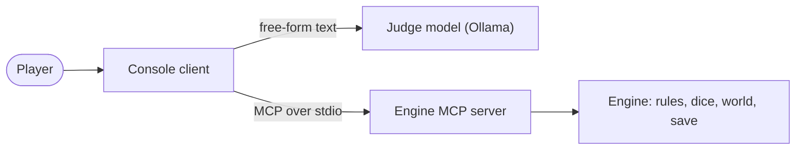

# DCC JUDGE

A console text adventure in the spirit of Zork, played under the Dungeon Crawl
Classics (DCC) rules. A Judge, played by a language model or by you with plain
commands, runs a 0-level funnel. The engine owns every rule, roll and record;
the Judge interprets the player and narrates.

```
 ██████╗  ██████╗ ██████╗         ██╗██╗   ██╗██████╗  ██████╗ ███████╗
 ██╔══██╗██╔════╝██╔════╝         ██║██║   ██║██╔══██╗██╔════╝ ██╔════╝
 ██║  ██║██║     ██║              ██║██║   ██║██║  ██║██║  ███╗█████╗
 ██║  ██║██║     ██║         ██   ██║██║   ██║██║  ██║██║   ██║██╔══╝
 ██████╔╝╚██████╗╚██████╗    ╚█████╔╝╚██████╔╝██████╔╝╚██████╔╝███████╗
 ╚═════╝  ╚═════╝ ╚═════╝     ╚════╝  ╚═════╝ ╚═════╝  ╚═════╝ ╚══════╝
```

## How it works



The engine runs as an **MCP server over stdio**. Any MCP client can act as the
Judge; the console client in this repository is one. Each turn, the player's
words go to the engine first. Plain commands are resolved directly. Anything
else is interpreted by the Judge model into a proposal, which the engine checks
and resolves. The model never decides a roll or changes the game by itself.

Documents:

- `docs/design.md`: the game's rules and architecture
- `docs/adventure-E01.md`: the first adventure, The Elder's Secret (spoilers)
- `docs/engine-notes.md`: what the engine does today, decisions to review
- `docs/backlog.md`: work saved for later

## Setup

Python 3.10+ is required.

```bash
python -m venv .venv
source .venv/bin/activate          # Windows: .venv\Scripts\Activate.ps1
pip install -r requirements.txt
```

For a Judge model, install [Ollama](https://ollama.com) and pull a model, for
example `ollama pull gemma4:12b`. The engine was tested with
`gemma4-12b-128k:latest`.

## Playing

The first argument is the adventure file, a path or an http(s) URL:

```bash
python src/cli/judge.py adventures/elders_secret/adventure.yaml           # plain commands, no model
python src/cli/judge.py adventures/elders_secret/adventure.yaml --model gemma4-12b-128k:latest
python src/cli/judge.py https://example.com/adventure.yaml --model llama3.1 --host http://server:11434
python src/cli/judge.py adventures/elders_secret/adventure.yaml --reset          # delete the save, start over
python src/cli/judge.py adventures/elders_secret/adventure.yaml --reset --seed 7  # start over with fixed dice
```

The game saves after every action and resumes where you left off. Type `help`
in the game for the plain commands, such as `look`, `go stair down`,
`sneak north door`, `search east wall`, `buy 4 torches`, `light torch`,
`all attack`, `flee way out`, or `Bram, take the crock`.

## Using another MCP client as the Judge

Run the server on its own and point any MCP client at it over stdio:

```bash
python src/servers/engine_server.py
```

`new_game`, `resume_game`, `reset_game` and `adventure_info` take the adventure as a file
path or an http(s) URL. Tools: `new_game`, `resume_game`, `reset_game`, `get_context`, `command`, `act`,
`customize_character`, `character_sheet`, `list_adventures`,
`encounter_level`, `judge_guide`. The `judge` prompt and `judge_guide` tool
explain the turn loop and the proposal format.

## Project layout

```
src/
├── cli/judge.py              console client (MCP client + optional model)
├── servers/engine_server.py  the engine as an MCP server over stdio
├── engine/                   world, actions, combat, rules, parser, saves
├── rulesets/dcc.py           DCC rule constants; loads DCC tables
├── rulesets/game.py          this game's rules; loads game tables
├── models/                   Item, Equipment, Condition
└── services/dice_service.py  dice expression parsing
data/tables/                  every table, as YAML
adventures/<id>/adventure.yaml  adventure data
tests/                        pytest suite
```

## Tests

```bash
pytest -m "not model"     # engine tests, a few seconds
pytest -m model           # Judge model tests; needs Ollama
```

Model tests use `DCC_JUDGE_TEST_MODEL` (default `gemma4-12b-128k:latest`) and
`DCC_JUDGE_TEST_HOST`, and are skipped when the model is not available.

## Data and logs

Saves go to `saves/` and Judge logs to `logs/` (both ignored by Git). Set
`DCC_JUDGE_DATA_DIR` to keep them elsewhere.
