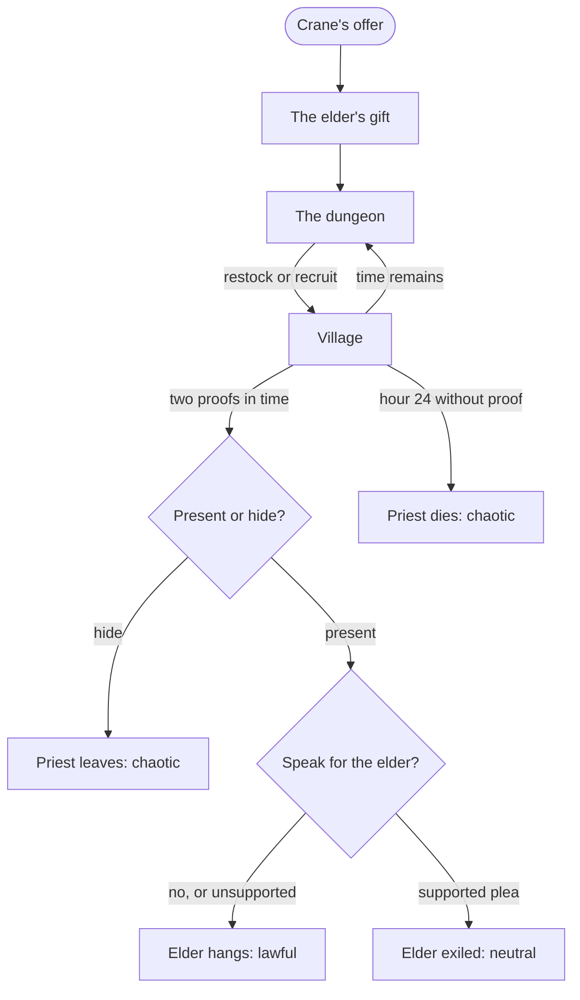
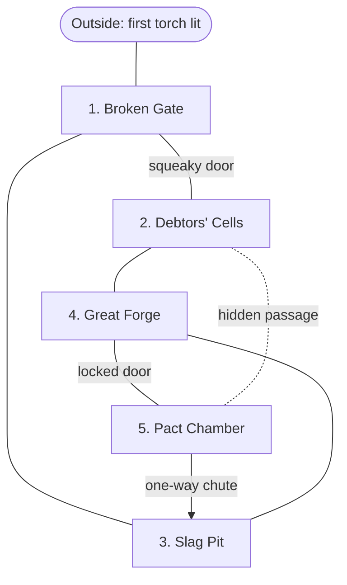

# Adventure: The Elder's Secret

A grim 0-level funnel for DCC Judge: four debtors, one village, a forge under the
hills, and twenty-four hours. The engine's rules are in `design.md`.

> **Spoiler warning:** this document reveals every secret. It is a planning
> document, not game data, and must never be part of the Judge model's input.

**Status:** first complete draft, awaiting review. Section 1 lists the brief: the
decisions made with the project owner, all kept in this draft. Everything else is
the adventure designer's work and can be changed. All numbers are untested.

## Contents

1. Brief
2. The truth
3. Design principles
4. Flow
5. The village
6. The dungeon
7. Wandering encounters
8. Creatures
9. Prisoners
10. Evidence
11. Wickdrinker
12. Choices that come back
13. Facts and secrets
14. The trial and the endings
15. Coverage
16. Adventure rules
17. Still open

## 1. Brief

- A five-room 0-level funnel, starting from a village.
- The elder made a pact with a demon. He used its power to save his infant
  daughter 20 years ago, and her life still depends on it.
- The village priest wants the elder hanged.
- The party must prove the pact. There are three pieces of evidence, any two are
  enough, and every pair proves the elder's part.
- The party has 24 hours. Going back to the village and out to the dungeon again
  costs 6 hours. The party is warned that time is short; the cause stays hidden.
- The dungeon is the place where the elder maintains the pact.
- The map in section 6, including the optional Pact Chamber and an earlier hint
  about the daughter.
- An item or weapon of great power, with a twist or flaw.
- Endings:
  - Hide the proof: the priest leaves, and the elder takes over.
  - Fail to find enough proof in time: the demon makes the priest die in his
    sleep, and the elder takes over.
  - Side with the priest and let the flawed trial run: the elder hangs, the
    daughter dies, and the priest leads a lawful village.
  - Speak up for the elder at the trial: he is exiled, the priest leaves, and the
    merchants' guild leads a neutral village.
- There is no fight with the priest. When the elder takes over, the village turns
  chaotic.
- At the trial, a relevant argument supported by what the party has learned
  succeeds without a roll.
- Village alignments give perks (to be defined) and influence the alignment of
  future recruits. They are flavour, not morality.
- A grim, dark story of hard choices. Stupid decisions can kill. A reward taken
  now can bite later.
- At least one minor fight, one puzzle and one trap. At most one major fight, and
  it is avoidable. Wit can get past fights and obstacles.
- **Encounters are not balanced.** Easy and hard ones both occur.

## 2. The truth

Twenty years ago, midwife **Maud Ferrin** delivered a girl who did not breathe.
The father, **Osric Hale**, carried the body into the hills to an old forge, where
something called **the Tallyman** keeps accounts. Maud followed him. She saw him
make the bargain and saw the child cry.

**The terms.** Osric was granted the power to move years from one person to
another. The child's life burns as a small flame in the forge. It stays lit only
if it is fed: **one life for each year of hers**.

Osric has used this power for nothing else. He has aged like any man. He became
village elder, and he is a good one: he lends grain, mended the well and forgives
small debts. Large debts he does not forgive. Each year, on Quarter Day, one
debtor, vagrant or stranger nobody will search for "goes to work off what is owed"
in the hills. None come back. He tells himself he chooses carefully.

**Maud** came to him and demanded he stop. He could not bring himself to kill the
woman who delivered his daughter, so he gave her to the goblins. She has spent
twenty years keeping other prisoners alive until they are counted.

**Skarn**, a goblin foreman, runs the forge for the Tallyman. He receives each
delivery with a note in Osric's hand and keeps every note.

**Wren Hale**, now 20, knows only that she falls sick each winter and recovers
when her father returns from the hills.

**Father Matthias Crane** is right about Osric and is not clean himself. The chapel
has debtors too. For years he has given Osric the names of those behind on tithes,
taking silver to settle each account, and has asked nothing about where they went.
Last week Osric's old carter confessed on his deathbed. Crane **broke the seal of
confession** and accused Osric from the pulpit. He has no proof. If the assize on
Quarter Day, tomorrow, finds none, Crane will be cast out for slander. He also
means to bury the list that carries his own mark.

**The silence clause.** The pact protects a debtor who keeps paying: *no accuser
without proof outlives a day*. Crane's day started when his proof-hunters set out.
If proof reaches the village in time, the accusation has grounds and the clause
lapses. If the party gives up the accusation by hiding the proof, Crane withdraws
it and leaves alive.

**What the Tallyman wants.** To be paid. While Osric pays, it collects one life a
year. If he hangs, the account closes and a closed account is collected in full:
the child's flame and the elder together. Either result suits it. It never fights.

## 3. Design principles

### 3.1 Names are debts

One rule underlies the dungeon: **in the Tallyman's house, a name can be owed.**
The prisoners' rack, the offer in the Pact Chamber and the voice in the dark all
use it. Oaths sworn there are recorded too. A player who learns this once can
survive, exploit and escape it.

- **Owed:** an owed person feels cold, and a mark of three strokes crossed by a
  bar rises on the palm.
- **Collection:** an owed person dies when the adventure's ending is resolved, or
  at hour 24, whichever comes first. There is no recovery check. A character who
  dies this way is not marked "ready to level up".
- **The mark:** the same three strokes and bar is Osric's chalk mark, and the
  rhythm of the forge: **three blows and a rest**.

### 3.2 Fair warning

Every deadly or delayed consequence has at least one clue available **before** the
choice. The Judge presents clues honestly and never adds a hint when the player
makes the choice.

For irreversible acts, the Judge restates plainly what the player is about to do
and waits for confirmation: swearing an oath; hanging or writing a living name;
giving a name to the Tallyman; answering the voice; handing someone to Skarn;
putting out the Child's Flame; and declaring that there is no case. The
confirmation guards against misreading, not against bad judgment.

### 3.3 No balancing

Creature numbers never change with party size, wounds, equipment or replacements.
Some foes fall to a frightened peasant with a shovel. Some will kill the whole
party if it insists. The world shows which is which through what can be seen,
heard and found.

### 3.4 No clean ending

Every ending costs something. Any two pieces of evidence reveal the price of the
daughter's life, so a party that wins the investigation knows what mercy costs.

## 4. Flow

1. **The offer.** Crane hires the party. The deadline starts when they set out.
2. **The gift.** Wren brings a pack from her father.
3. **The hills.** The party explores, chooses routes and gathers evidence.
4. **The way home.** Escaping matters as much as finding.
5. **The reckoning.** Hide the proof or present it. If presented, hang the elder or
   plead for him.
6. **Collection.** Debts and oaths come due.

### 4.1 Three roads to proof

| Evidence pair | Road | What it risks |
|---|---|---|
| Witness and letters | Gate, Cells, Great Forge | The rack puzzle; Skarn; keeping Maud alive |
| Letters and tablet | Gate, Slag Pit, Great Forge, Pact Chamber | The trap; the husk; Skarn and the locked door; the way out |
| Witness and tablet | Gate, Cells, hidden passage, Pact Chamber, chute | Finding the passage; the chute with a frail woman; the Slag Pit |

The first two need neither a hidden passage nor a particular check.

### 4.2 Time and light

All dungeon transitions take 10 minutes, including the one between outside and the
Broken Gate. The first torch lights free outside.

| Run, with no detours or mishaps | Timed actions | Torches in light |
|---|---|---|
| Witness and letters, by stealth | About 8 | 2 |
| Letters and tablet | About 7 | 2 |
| Witness and tablet | About 9 | 2 |
| Every room and every prisoner | About 18 | 3 |

Darkness multiplies these. Four torches leave little room for a party that gets
soaked or lingers. The gate fire, the forge fire and the Child's Flame light their
rooms. A clever party can save torch time there by putting its torch out and
relighting it from a fire. The Child's Flame charges for that (section 6.5).

The 24 hours are generous for one careful expedition. They punish repeated trips.

## 5. The village

The village's name is rolled on the village name table when the game starts
(`design.md` section 13); this document calls it **Emberwick**. It is a
mud-street village under bare hills. It is safe and lit: no
combat and no random encounters. If a character attacks a villager, neighbours pull
them off before anyone is hurt, and the target will no longer speak with them.

> Rain has not fallen in a month. Debt notices are nailed to the chapel door,
> because tomorrow is Quarter Day. Across the green, someone is stacking fresh
> timber and will not meet your eye.

### 5.1 The tavern hook

The game begins in the village tavern, whose name is also rolled. The four
characters share a jug they cannot pay for, on the eve of Quarter Day. The Judge
offers two actions: **glean rumors** and **visit the shopkeeper**.

**The hook.** The first time they glean rumors, the talk dies as Father Crane
comes in out of the rain, grey-faced and coughing. He sets a tithe ledger on their
table and taps four lines: their names. **Each is behind on tithes.** He offers to
strike their debts if they bring proof by this time tomorrow. He explains the
assize, not the confession. He says only that Hale "settles his accounts at the
forge under the hills". He leaves a copper for their jug and goes. The road out
of the village is now open: a third action, **take the road**, appears.

Crane is approached the same way in every game, because a 0-level party is
always offered a funnel's hook (`design.md` section 13). Players who want to
know more can find him at the chapel before leaving.

He will say that proof means "his hand, his name, or a living witness", and that
one thing alone can be called a forgery, a lie or goblin work. He needs two.

**Later gleanings** give the tavern rumors in section 5.4, one at a time.

The deadline clock starts when the party leaves the village. The first journey is
3 hours. While the party prepares, Crane coughs, and says he slept badly.

### 5.2 The elder's gift

As the party first leaves, **Wren** catches them at the well with a pack.

> "Father says whoever walks the hills should have light. He packed it himself.
> He says come home safe."

The pack holds **6 torches, flint and steel and 2 wound dressings**. Its flap bears
three chalk strokes crossed by a bar. For a party this poor it is a fortune. It is
also how Osric labels a delivery: **he has sent them as this year's payment**.
Wren does not know.

Warnings available before taking it:

- The mark is plainly visible.
- If asked about the hills or the mark, **Hester Gage** the shopkeeper says: "The
  tinker, Corin, set off with a pack chalked like that. Owed Hale thirty silver.
  Never came back."
- The same mark is chalked on the elder's grain sacks.

The party can accept, refuse, empty the pack and leave it behind, or rub out the
mark (free, if the player says so). Goblins only recognise the **marked pack**.

### 5.3 Wren

Talking is free. Asked about herself, her father or the hills, Wren says:

> "Every midwinter I go down sick. Last year I couldn't lift a spoon. Father walks
> up into the hills, and by the third day I can stand. He says there's a spring."

She shows, if asked how the sickness feels, a round mark over her heart like the
seat of a candle. "It's warm. It's always warm." This is the **early hint**, and
it can support a plea. It needs no check.

She is kind, curious and fond of her father. She gives one character a heel of
bread for the road.

### 5.4 People and places

| Place | Who | What they offer |
|---|---|---|
| The tavern (name rolled) | Regulars; Father Crane | The hook on the first gleaning, then rumours. No recruits during the funnel. |
| Chapel | Father Crane | Answers questions about the offer; receives proof; convenes the trial |
| Elder's house | Osric, Wren | Wren's account. Osric is warm, calm and admits nothing before evidence exists. |
| Shop | Hester Gage | Buying and selling; the Corin rumour |
| The well | Volunteers | Up to four replacements over the run (see `design.md`) |

**Tavern rumours** (free; one per question):

- "Hale's good to folk. Fed us two lean winters running."
- "Someone leaves for the hill works every Quarter Day. Wages must be good. None
  come back to say."
- "Old midwife vanished the winter the Hale girl was born."
- "Crane's been poorly since he shouted at Hale."
- "Priest's the one who writes down who owes what. Ever notice?"

**Healing supplies:** wound dressings cost **30 cp**. The shop has **3** for the
whole run.

### 5.5 Coming home

- **Warnings:** each return, the Judge gives the approximate time left. Crane looks
  worse: coughing, then grey and unable to stand, then barely awake after hour 20.
  The gallows on the green is finished by the second return.
- **Maud:** if brought into the village, she walks straight to the chapel and
  tells what she saw. A party that wants to hide her must ask her to wait outside
  **before** entering. She agrees unless someone has sworn her oath.
- **Garr:** see section 9.
- **The elder's coin:** once Osric knows the party carries evidence, he offers
  **200 cp** to burn it and tell Crane there was nothing. He does not threaten. He
  weeps once, if refused, and says only "You don't know what you're spending."
  Each coin is chalked with a tiny stroke-and-bar. Accepting **and** destroying or
  surrendering enough evidence to leave fewer than two pieces counts as hiding it.
- **Elder warned:** if this flag is set, Osric meets the party on the road with
  the coin, and keeps Wren indoors. Reaching her then takes a convincing ruse or a
  moderate Personality check at the door.
- **Not enough proof:** Crane takes nothing as sufficient with fewer than two
  pieces. The party may go back while time remains.

## 6. The dungeon

Beneath the hills lies a forge older than Emberwick. Goblins work it. They see in
the dark.

Plain lines are two-way, the arrow is one-way and the dotted line is hidden.

| Room | Role | Light | Wandering table |
|---|---|---|---|
| 1. Broken Gate | Minor fight, first choices | Lit by the goblins' fire | Yes |
| 2. Debtors' Cells | **Puzzle**, prisoners, hidden passage | Dark | Yes |
| 3. Slag Pit | **Trap**, darkness hazard, temptation | Dark; the slag's glow is too faint to see by | Yes |
| 4. Great Forge | **Avoidable major fight** | Lit by the forge | No |
| 5. Pact Chamber | The truth and the cost | Lit by the Child's Flame | No |

In the room entries below, **Shapes** is the infravision description and **Touch**
covers the party without sight, including sound and smell. A dash means the object
cannot be perceived that way. Names given to the Judge must be filtered the same
way as descriptions.

### 6.1 Room 1: Broken Gate

**Light:** A gatehouse has fallen in on itself. Between leaning blocks, a cookfire
throws orange light on a heap of old boots, none of them a matching pair.

**Shapes:** Tumbled blocks lean around a gap. A fire's heat shimmers. Beside it is
a high heap of boot-shaped things.

**Touch:** Broken stone underfoot. Smoke, frying fat and old leather. Water drips
somewhere below.

| Object (`id`, material) | Light | Shapes | Touch |
|---|---|---|---|
| Lintel (`gate_lintel`, stone) | Deep letters read ANSWER NOTHING THAT CALLS YOU BY NAME. Below them, three chalk strokes and a bar. | Deep-cut letters, same words | Deep-cut letters, readable by finger; same words |
| Boot heap (`boot_heap`, leather) | Dozens of boots, worn through or nearly new. | A heap of boots | Boots, many sizes |
| Cookfire (`gate_fire`, wood) | A small fire with a pan on it. | Flickering heat and a pan | Heat, spitting fat |
| Oil crock (`oil_crock`, clay) | A crock of lamp oil sits by the fire. | A squat lidded pot | A greasy pot that smells of lamp oil |
| North door (`squeak_door`, wood) | A plank door sags on two rusted hinges. | A sagging door on two hinges | Planks; flaking hinges |
| Stair down | Wide steps descend toward a dull glow and heat. | Wide steps descending into warmth | Steps descending; rising heat |

**The sentries:** Nib and Rustle share the pan and argue. Before they notice the
party, listening is free. Their quarrel gives away:

- "Skarn says melt the dead 'uns for nails. Rail takes a dead 'un same as a live
  one. Waste, that is."
- "Say it on his left side, then. He boiled that ear off. Can't hear a thing."
- "Count's due. Hale's late."

**Getting past:**

| Approach | Result |
|---|---|
| Fight | The minor fight. If one dies, the survivor checks morale. Nib surrenders; Rustle flees by the Slag Pit stair. |
| Stop a runner | Each character able to reach Rustle gets one attack as he goes. If he gets away, the forge is **alerted** 10 minutes later. |
| Sneak | A silence check, or clever cover such as slipping past while the pan spits and they shout. |
| Distract | A thrown stone, offered food or a faked voice can draw them off. Strong food, such as stinky cheese or a side of beef, works without a roll. |
| Bluff | A Judge-ruled check. Claiming to come from Skarn is easier after hearing their quarrel. |
| Delivery | See below. |

**Delivery:** if the sentries see the marked pack, they stand up without drawing
weapons. "Delivery. Walk." They expect deliveries to arrive docile.

- **Refusing** starts a fight, or the party can talk its way out.
- **Following** takes the party through the Cells to the Great Forge. Skarn asks
  each name, scratches it on a tag and hangs the tags on a hook by his desk. He
  takes the pack and leaves the "delivery" by the forge while a heat finishes:
  10 minutes with their weapons still on them and the room's secrets within reach.
  The tags can be taken back from the hook during that time.
- **After the heat,** Skarn walks the delivery and its tags to the Cells. **A true
  name hung on the rail is owed,** and its owner is locked in a cell. A false name
  does not move the rail. Skarn sees that, and attacks.

A party that gives false names has turned Osric's betrayal into an escort past the
cells and into the heart of the forge.

**Nib, surrendered:** he knows Skarn's deaf left ear, that the smiths strike "three
and a rest", that Skarn keeps the far door's key on his belt, and that the rail
takes dead names.

- **Released:** he promises silence, then glances toward the forge. He mutters that
  Skarn skins goblins who fail to report. The forge is alerted in 30 minutes.
- **Tied up:** he chews free in 60 minutes and reports.
- **Persuaded** that Skarn will blame him (moderate Personality, or no roll for a
  sharp argument): he runs from the hills for good.
- **Killed:** he stays quiet. He asks them not to.

**Squeaky door:** opening it unoiled is loud. This raises the encounter level and,
if the sentries are alive and unaware, brings them. Oil from the crock, a flask of
oil or another plausible grease silences it permanently. The crock holds one use
for the hinge; using it for anything else uses it up.

### 6.2 Room 2: Debtors' Cells

**Light:** A long, low gallery. Three barred cells face an iron frame bolted to the
wall. Thousands of short strokes are scratched into every surface, in groups of
three and a bar. Someone in the second cell is humming a cradle song.

**Shapes:** A long gallery with barred openings facing an iron frame. Lines of
short cuts cover the walls. A figure sits in one opening.

**Touch:** Cold walls ridged with scratches. Iron bars. The smell of unwashed
people. Someone hums a cradle song; someone else coughs.

| Object (`id`, material) | Light | Shapes | Touch |
|---|---|---|---|
| Tally rack (`tally_rack`, iron, unbreakable) | An iron frame holds a long rail of six pegs on a counterweight, with a tray beneath. Rods run from it to the cell bolts, and a wire runs on toward the forge. Three pegs hold tags. | A frame with a rail of six pegs, three occupied, a tray, rods to the cells and a wire leading away | A swaying rail with six pegs, three tags with stamped letters, a tray, rods and a taut wire |
| Cells (`cell_1` to `cell_3`, iron bars in stone) | Iron bars, bolts sunk into stone sockets. | Bars and bolts | Bars; bolts set in stone |
| Wall words (`wall_words`, stone) | Cut larger than the tallies: THE RAIL CANNOT TELL THE QUICK FROM THE DEAD. Below, in a different hand: NEVER GIVE IT BREATH. | Large cut letters, same words | Same words, readable by finger |
| Bone niche (`bone_niche`, stone) | A niche holds knuckle bones, twists of hair and scraps. | A cluttered niche | Small bones, hair, cloth |
| Smith's bench (`tag_bench`, wood) | A bench with a bucket of blank iron tags and a scratch awl. | A bench, bucket and pointed tool | A bucket of smooth iron slips; a sharp awl |
| Jailer's chair (`jailer_chair`, wood) | A heavy chair with one short leg, propped on a stone. | A heavy chair | A heavy, wobbling chair |
| East wall (`east_wall`, stone) | Fitted stones. A torch held near them leans and flutters. | Fitted stones | Cold air seeps between stones |

The jailer's chair can be broken for a club, following the breaking rules.

#### The tally rack (puzzle)

The tags read **MAUD FERRIN**, **TOBIN REED** and **GARR PELL, OWES BLOOD**. Each
tag matches a cell.

**Rules:**

1. Lifting a cell's tag into the tray draws that cell's bolt.
2. **The rail must never carry fewer than three accepted names.** If it does, a
   drop bar slams down, all remaining bolts lock and the bell rings in the forge.
3. The rail **accepts** an iron tag bearing a real person's name, living or dead,
   that is not already on it. It dips with a clunk.
4. A blank tag or invented name hangs without moving the rail.
5. A living person is **owed** while their name hangs on the rail.

So the party hangs a substitute first, then lifts a prisoner's tag. Rehanging or
lifting tags is one 10-minute task, however many moves the command contains.
Hanging is safe for dead names. The rail's dip shows what it accepts before the
party risks lifting anything.

**Where to find names:**

| Source | Cost |
|---|---|
| **Bone niche:** two tags set aside for melting, ALDA BROOK and WAT HILLMAN. A 10-minute search finds them. | Time. Only two tags for three prisoners. |
| **Corin's tag** in the Slag Pit | Reaching it, putting Corin to rest and coming back |
| **A blank tag scratched with any dead person's name** | The letters only take in the scratcher's blood: **1 HP per tag.** This can drop a character to 0 HP. |

Dead names the party might know include its own fallen, those on the Pact Chamber
wall, the owner of Wickdrinker, and those Maud can recite from her cell if asked.
She warns that scratching one will drink blood.

**Other ways:**

| Approach | Result |
|---|---|
| Scratch or hang a **living** name | It works instantly and quietly, with 1 HP of blood if scratched. That person is owed. |
| Lift a tag with no substitute | Drop bar and bell. Lifting the bar takes a 10-minute task and a hard Strength check. |
| Break a bolt socket with an item that breaks stone | Frees one cell per 10 minutes. Loud, and the broken rod rings the bell. |
| Scratch SKARN | It is accepted: he is living. He feels the mark rise, and the forge is alerted at once. He dies at collection, which is too late to help much, unless the party can wait him out. |
| Scratch OSRIC HALE | The cuts fill themselves smooth: he is already in the book. This is a clue, not evidence. |
| Scratch WREN HALE | The awl will not mark the iron. "The flame is not owed to itself," says Maud, if she can hear. |
| Scratch an absent villager's name | Accepted. That villager dies at collection. |

An owed living name is **redeemed** by lifting its tag off the rail, provided at
least three accepted names stay on it.

**Reward and bite:** the dead names are the free road, but there are only two
without more work. A party short of time must choose who stays, bleed for another
tag, or hang someone who still breathes.

**The bell:** 10 minutes after it rings, Skarn and one smith reach the Cells. They
search for 20 minutes and take 10 minutes to return. The forge is short-handed
during that time. A clever party can ring the bell on purpose, leave, and circle
through the Slag Pit while Skarn is away. Hiding from the searchers instead takes
a group silence check or a good hiding plan.

#### The hidden passage

A narrow flue behind the east wall climbs to the Pact Chamber. Osric uses it so he
need not walk past the cells.

| Clue | Source |
|---|---|
| A flame leans toward the wall | Plain, with a light |
| "Someone walks inside that wall in winter." | Tobin, if asked what he has seen or heard |
| Exactly which stones to pull | Maud, only after her oath |

- Searching **the east wall** finds it with no roll. Searching the whole room needs
  a moderate Intelligence check.
- Elves get a passive check on entering (hard Intelligence).
- Characters crawl one at a time. **The Pact Tablet is too wide to pass.**

### 6.3 Room 3: Slag Pit

**Light:** A cavern floor of grey crust, cracked and glowing dully underneath. A
stone causeway crosses it. Iron channels hang overhead, and the walls are streaked
where water has run. At the far side, under a square hole in the roof, lies a deep
black pool.

**Shapes:** A causeway over a broken crust that gives off waves of heat. Channels
overhead. A pool beneath a square opening in the roof.

**Touch:** Fierce heat on both sides of a narrow stone walk. A cold drip from
above. Somewhere ahead, water smacks against stone.

| Object (`id`, material) | Light | Shapes | Touch |
|---|---|---|---|
| Causeway prints (`prints`) | Goblin footprints cross the grime, except on one slab, which every trail strides over. | Footprints that stride over one slab | A groping hand finds grime worn smooth everywhere but one slab |
| Slag crust (`slag_crust`, stone) | Crust over slow, glowing slag. | A cracked, shifting, hot surface | Heat; crust crackling at the edges |
| Quench sluice (`sluice`, iron) | A gate in the overhead channel, tied by a rod down to the causeway. | A gate in a channel with a rod to the floor | Cold drips; a rod running down into the stone |
| The sitter (`ysolde_body`) | A dried-out woman sits against a pillar among a dozen burnt-out torch stubs. A narrow black sword stands in her lap. A scabbard reads YSOLDE MARR. | A seated body among short sticks, a narrow sword in its lap, letters tooled on a scabbard | A dry body, burnt stubs, a cold sword hilt wrapped in waxed cord, tooled letters |
| Her satchel (`ysolde_satchel`, leather) | A satchel with 1 wound dressing and a note: "It eats the light. Don't." The rest has rotted. | A satchel holding a rolled cloth and a scrap | Cloth bandage and brittle paper |
| Wanderer (`corin`) | A grey, shrunken man shuffles along the far ledge, patting his empty pockets. A tag hangs at his neck. | A thin figure shuffling and patting itself | Dragging feet; a dry voice asking "Is it paid? Is it paid?" |

By touch alone, the scrap cannot be read.

#### The quench plate (trap)

The slab all the footprints avoid opens the sluice. Quench water hits the hot slag
and the causeway fills with steam.

- **Effect:** every open flame goes out. Each creature on the causeway makes a
  moderate Agility check or takes **1d4** damage. This can kill.
- **Repeats:** the sluice refills in 10 minutes.
- **Without a precaution,** the first character across steps on it.

| Wit | Result |
|---|---|
| "Step where the goblins step", or stride over the slab | Safe, no roll |
| Wedge it with an iron spike or similar | Safe until removed |
| Probe ahead with a pole | Finds it. If the party pushes it from a distance, everyone off the causeway is safe, but nearby torches go out. |
| Spring it on purpose with pursuers on the causeway | Pursuers take the effect. A deadly weapon for a party that remembers it. |
| Search the slab or sluice (10 min) | Reveals how it works |

**Leaving the causeway:** the crust is not floor. Each character who tries it makes
a hard Agility check or takes **2d6**. A thrown stone breaks straight through.

#### Corin Ashby, the husk

Corin was drained but miscounted, and did not die. He walks toward **flame** and
tries to take it, as if he could get back what was burned away.

- A party with no flame can pass him without a fight.
- A torch set down or thrown draws him to it. He stands and stares at it.
- **Answering him** ends it. If a character calls him by name and tells him that
  his debt is paid, which is true, he sighs, hands over his tag and lies down.
  He is then dead. His name is on the tag and on a pack beside the causeway that
  bears the **elder's mark**. Maud and Tobin know he "kept asking whether he was
  paid".
- Fighting him is a fight with one creature. Dead, he leaves his tag.

#### Ysolde's sword

Eight years ago a sellsword came to break the pact. She had Wickdrinker. She ran
out of light. Her sword is there for the taking (section 11). Drawing it or
carrying it **past Corin** draws him to the blade's wielder, since the nearby flame
leans toward it.

#### The sump

The chute from the Pact Chamber drops into the pool (section 6.5). The climb back
up the chute is impossible.

### 6.4 Room 4: Great Forge

**Light:** Heat and noise. Three goblins strike at anvils around a roaring forge:
three blows and a rest, three blows and a rest. At each rest they look up and
count. A huge goblin hauls a bellows chain with his back to a high desk. Beyond the
desk is an iron-banded door.

**Shapes:** Three small figures at anvils around a great heat. A large figure pulls
a chain with his back to a tall desk. Beyond it, a banded door.

**Touch:** Crushing heat. Hammers ring three times, then stop for a breath, and
again. A heavy chain rattles. A deep voice counts.

| Object (`id`, material) | Light | Shapes | Touch |
|---|---|---|---|
| Satchel (`receipt_satchel`, leather) | A fat satchel hangs from a nail on the desk post. Two wax seals show on papers poking out: a stroke-and-bar and a chapel cross. | A bulging satchel with two raised seals | A stuffed satchel; two wax seals, one cross-shaped |
| Skarn's key (`skarn_key`, iron) | A long key swings from Skarn's belt. | A long key at a large figure's belt | — |
| Quench trough (`quench_trough`, wood) | A long trough of water beside the forge. | A long full trough | Wet wood; water |
| Crucible (`crucible`, iron) | A pot of molten metal on a tipping chain. | A hot pot hung on a chain | Savage heat; a creaking chain |
| Nail bins (`nail_bins`, wood) | Bins of crude nails, some still showing pieces of stamped letters. | Bins of nails | Nails, a few with stamped ridges |
| Far door (`pact_door`, wood, iron-banded) | Oak and iron, locked. | A banded door | Oak, iron bands, a keyhole |
| Coin jar (`coin_jar`, clay) | A jar on the desk holding 60 cp. | A jar of small discs | Loose coins |

**Skarn** keeps accounts, not grudges. If the party walks in openly without
drawing weapons, he talks before he fights. If they draw first, or are seen
stealing, he attacks.

#### Getting what you want without the fight

| Approach | How it works | Gets |
|---|---|---|
| **Three and a rest** | A player who moves on the blows and freezes at the rest moves silently, no roll. | Crossing the room unseen |
| **The deaf side** | Skarn's left ear is gone. Anyone using the rhythm and coming up on his left can lift the satchel with no roll. | The satchel |
| **The belt** | Lifting the key from a moving giant needs a hard Agility check, even on his deaf side. Failure starts the fight. | The key |
| **Decoy** | A stuffed bag or bundle left on the nail hides the theft. Skarn never notices. | No alarm later |
| **Ring them away** | Use the tally bell (section 6.2) and arrive while Skarn is gone. | An easier forge. The key leaves with Skarn. |
| **The delivery** | See section 6.1. | A free 10 minutes inside |
| **The collector** | A character carrying drawn Wickdrinker claims to collect for the Tallyman. The flames lean. The smiths run. Skarn asks "Whose account?" Naming Osric Hale as short settles it. Any other answer needs a hard Personality check. Success: Skarn hands over satchel and key to prove his books are clean. Failure: he fights. | Everything. **Skarn sends word to Osric** (elder warned). |
| **Dark the forge** | Tip the trough into the fire. The room fills with steam and goes dark for 10 minutes. **The goblins see in the dark.** Helpful only to a party prepared for it. | Cover for a party that can see |
| **Pick or break the door** | Thieves' tools and a hard Agility check, or a hard Strength check to break it. Breaking is loud, and Skarn hears it. Burning it takes 30 minutes and smoke alerts the forge. | The door, if the goblins are gone or deceived |
| **The back way** | Use the hidden passage and avoid this room entirely. | The Pact Chamber |
| **The trade** | Skarn's own offer: "Put a fresh one on my rail. Then take what you like." | Satchel and key, and safe passage |

**The trade:** the party hands Skarn a freed prisoner or one of its own. He refuses
Maud ("Hale's orders"). The person he takes dies. The party gets exactly what it was promised. If Maud is present,
or later hears of it, she will not testify: **the witness is lost as evidence.**
The traded person's name comes up in the endings.

**Reading the satchel:** looking through it takes 10 minutes here and is free in the
village. Grabbing it and going saves time (section 10).

#### The fight

Skarn and three smiths. This is a **very hard fight**, and likely fatal to a party
that walks into it.

- The front rank has room for three on each side.
- **Skarn is the chief.** The group morale rules apply. If the smiths break and he
  is left alone, he counts as a single monster. At half HP, alone, a failed morale
  check makes him **surrender**: he offers the key and satchel for his life.
- **Crucible:** one action and a hard Strength check tips it. Choose a target
  beside it. The target, and anyone engaged with the target, makes a hard Agility
  check or takes **3d6**. Friends included.
- **Quench trough:** one action and a moderate Strength check floods the floor with
  steam, putting out torches and the forge for 10 minutes.
- The goblins **never strike Maud**. Osric forbade it.
- Smiths who flee leave the dungeon.

#### Forge states

| State | Cause | Effect |
|---|---|---|
| **Working** | Start | Hammering; the rhythm gives cover |
| **Alerted** | A runner arrives, the bell rings, Skarn's name is scratched, a loud action in the forge or a failed attempt to cross unseen | The smiths hammer only in bursts, so there is no reliable rhythm. The goblins are armed and cannot be surprised. |
| **Paused** | A wandering event | No rhythm for 10 minutes |
| **Empty** | The goblins are dead or have fled | Everything in the room is free to take. The fire keeps burning. |

**Elder warned:** this flag is set when Skarn is alive, free to send word and knows
the satchel or tablet is gone. A theft without a decoy is noticed after 30 minutes,
even if the party has left.

**After a trip home:** if the goblins had been alerted, or the gate sentries are
missing, the forge stays alerted. If it was alerted and a prisoner other than Maud
is still locked up, Skarn has **spent** one: Tobin first, then Garr. The empty cell
holds only clothes.

### 6.5 Room 5: Pact Chamber

No furnishings may be added here by the Judge.

**Light:** A small round room, warm and clean. Someone sweeps it. In the middle
stands a plain wooden cradle. In it, in an iron lamp, burns a single steady flame
no taller than a thumb. The curved wall is covered in names, one beneath another,
each with a stroke beside it.

**Shapes:** A small round room. A cradle in the middle holds a lamp whose flame
is a small shifting heat. Rows of cut writing cover the wall.

**Touch:** Warm, still air smelling of lamp wax. A cradle with a lamp, too hot to
hold. Rows of carved letters on a curved wall.

The Child's Flame lights the room.

| Object (`id`, material) | Light | Shapes | Touch |
|---|---|---|---|
| Child's Flame (`child_flame`, iron lamp, unbreakable and fixed) | A flame that breathes: it swells and sinks in a slow, sleeper's rhythm. | A small heat that swells and sinks slowly | A warmth that comes and goes like breathing |
| Cradle (`cradle`, wood) | A cradle with a folded blanket, soft and new. Carved on its foot: NONE BUT HER. | A cradle, a folded cloth, cut letters on its foot | A soft blanket; letters reading NONE BUT HER |
| Pact Tablet (`pact_tablet`, stone, unbreakable, bulky) | A slab at the foot of the cradle, cut close with writing. | A flat lettered slab | A heavy slab with deep lettering |
| Name wall (`name_wall`, stone) | Twenty names, one for each year. The last space is smooth. | Rows of cut writing | Twenty carved names |
| Chute (`chute`, stone) | A square mouth in the floor. Cold air and the smell of wet ash rise from it. | A square opening dropping away | A square opening; cold wet air; faint slapping water |

Reading the name wall carefully is a 10-minute search. It gives **twenty dead
names**, including some that villagers will know.

**The tablet** reads, in part:

> OSRIC HALE, FATHER, TAKES THE MOVING OF YEARS, FOR THE CHILD ALONE.
> A LIFE FOR EACH YEAR OF HERS, WHILE SHE BURNS.
> ALL THAT IS OWED BY NAME IS OWED TO THE FLAME. WHEN THE FLAME ENDS, SO DOES
> THE OWING.
> WHILE THE DEBTOR PAYS, NO ACCUSER WITHOUT PROOF SHALL OUTLIVE A DAY.

Reading it takes a 10-minute search.

#### The Tallyman's offer

When someone first lifts the tablet, a dry, patient voice speaks from the lettering:

> "A long way home, and so little light. I have a candle that never ends. Give me
> a name that stands in this room."

- The name must belong to someone **present**: a character or Maud. A spoken name
  is enough. That person is **owed**.
- **The Tallyman's Candle** is a light source that never burns down. It can be put
  out and relit freely, occupies a hand and Wickdrinker cannot feed on it.
- It goes out forever when its named person is collected or when the Child's Flame
  ends.
- Saying nothing costs nothing. The offer is not repeated.

For a party stuck in the dark with a dying torch, this is the best thing in the
dungeon. It costs one friend.

#### The Child's Flame

The flame has **3 steps**. Each loss is visible: it shrinks and its breathing
catches.

| Act | Cost |
|---|---|
| Lighting a torch from it (free action) | 1 step |
| Each Wickdrinker hit in this room | 1 step, in place of torch time |
| Deliberately putting it out (confirmation required) | All steps |

Nothing else harms it. Accidents, wind and fighting do not.

| Steps left | Wren |
|---|---|
| 3 | As before |
| 2 | Pale and coughing |
| 1 | Cannot rise or speak. Her account can no longer be heard. |
| 0 | Dead, at that moment |

**If the flame ends:**

- Wren dies.
- **Every name owed to the flame is released,** on the rail and for the candle.
  Owed marks fade. All cell bolts draw back. **Oaths are not released.**
- Every goblin in the dungeon screams and flees for good, leaving the forge empty
  and Skarn's key and satchel behind.
- The pact itself stands: the silence clause and the deadline remain.
- Osric knows at once. He is warned.

It is the greatest immediate reward in the adventure: debts gone, doors open,
enemies fled. It is paid for with a girl who gave the party bread.

#### Leaving

| Way | Notes |
|---|---|
| **Locked door** | From either side, the same key, picking or breaking applies. Breaking it brings any goblins still in the forge. |
| **Hidden passage** | The tablet does not fit |
| **Chute** | Fast, one-way and wet |

**The chute:** each rider makes a moderate Agility check or takes **1d3** damage,
and everyone lands in the sump in the Slag Pit.

- All lit torches go out.
- Unlit torches are **soaked** and cannot be lit for 60 minutes of game time.
- **Parchment is ruined**, including the letters.
- Items in a waterproof sack stay dry.
- The tablet is unharmed but sinks. Recovering it takes a 10-minute search.
- Flint and steel survive.

Warnings: cold wet air and the slap of water rise from the mouth; a dropped pebble
splashes; Maud, after her oath, says it ends in the quench sump.

The chamber always has at least two ways out: the passage and the chute.

## 7. Wandering encounters

The starting encounter level is 1. The table applies in rooms 1 to 3. Rolls that
land on a spent entry are taken from the remaining entries.

| Weight | Encounter | Difficulty | Limit |
|---|---|---|---|
| 3 | **Cinder rats:** three of them nose at the party's packs. A waved torch sends them off with no roll. | Easy | 2 packs |
| 1 | **The runt:** one starving goblin gnawing a boot. It will trade anything it knows for food: that the rail takes dead names, and where the Gleaner walks. | Trivial | 1 |
| 2 | **Count-takers:** two goblins with a net, looking for strays. They fight like smiths and flee to the forge, alerting it. Their count is owed to Skarn; they can be bribed. | Moderate | 1 pair |
| 1 | **The hammers stop.** The forge is paused for 10 minutes. Silence spreads through the halls. | Event | None |
| 1 | **Footsteps in the wall.** Slow, heavy human steps pass behind the stones of the Cells' east side. It is Osric only if he is warned; otherwise it is the memory of his steps. A clue to the passage. | Clue | 1 |
| 1 | **The voice:** a familiar voice calls one character by name. **Anyone who answers to their name is owed.** Saying nothing, or answering without accepting the name, is safe. | Peril | None |
| 1 | **The Gleaner** | **Deadly** | Persists |

A character is only bound if the player has them answer. The Judge must not treat
an unclear command as an answer. Warnings: the gate lintel, and Maud and Tobin if
asked what to fear.

### The Gleaner

Something that carries off what the forge discards. It is much too strong for this
party, and it is **not a set-piece fight**.

- It is heard first: wet dragging, getting closer. The party always has one action
  before it arrives.
- It is **blind** and hunts by sound. A successful group silence check, or a good
  way to stay still and quiet, lets it pass.
- A noise made elsewhere draws it away.
- It is **slow**: fleeing from it gives it no parting attack.
- Offered a body, it takes it and leaves. A companion who has fallen and has not
  been checked is a body. **If it takes them, they die.**
- Warnings: long drag grooves on the Slag Pit causeway, and Tobin: "If you hear
  something dragging, don't breathe."

## 8. Creatures

Numbers are fixed. Goblins have infravision.

| Creature | HP | AC | Attack | Damage | Morale | On failed morale |
|---|---|---|---|---|---|---|
| Nib (sentry) | 3 | 10 | +0 | 1d3 | 6 | Surrenders |
| Rustle (sentry) | 3 | 10 | +0 | 1d3 | 6 | Flees to the forge |
| Runt | 2 | 9 | -1 | 1d3 | 4 | Surrenders |
| Cinder rat (3) | 1 | 10 | +0 | 1 | 5 | Flees |
| Count-taker (2) | 4 | 11 | +1 | 1d4 | 7 | Flees to the forge |
| Goblin smith (3) | 5 | 11 | +1 | 1d4 hammer | 7 | Flees the dungeon |
| **Skarn** (chief) | 22 | 14 | +3 | 1d8+2 | 9 | Surrenders (only when alone) |
| Corin, husk | 10 | 10 | +1 | 1d4 | Never checks | — |
| **The Gleaner** | 30 | 13 | +4 | 1d10 | Never checks | — |

Skarn's morale entry is his own score as a lone creature. While he leads the
smiths, their group uses their score plus the chief's bonus.

**Servants of the Tallyman:** all goblins, Skarn and the Gleaner. Corin is a
victim, not a servant.

## 9. Prisoners

Prisoners are fixed by name. When one joins as a character, the engine generates a
0-level character with that name and the changes listed. A prisoner joins only if
there is a free slot. One not taken in heads for home alone, except as noted, and
does not reach the village during the run.

### Maud Ferrin, the witness

A midwife, now old and thin, humming the song she sang to every child she
delivered. She is **evidence, not a party member**: she takes no slot, does not
fight and can carry a light.

- **HP 2, AC 10.** She stays in the rear. Goblins never strike her. Traps, falls,
  rats, the Gleaner and her own clumsiness can. At 0 HP she dies; no recovery
  check.
- **Freely, if asked:** names are debts; "never give it one that breathes"; do not
  answer to your name; the dead names she remembers; Corin kept asking whether he
  was paid.
- **Her hint:** "That girl was dead in my hands. Every winter her father comes to
  trim her wick. Ask him what burns downstairs."
- **Her price:** she wants the elder to hang. Once freed, she asks the one who
  freed her:

> "Swear to me he hangs. Careful, now. Words sworn down here are heard."

If a character swears, she tells which stones open the passage, how the quench
plate works and where the chute ends. If refused, she still comes and still
testifies, but keeps those secrets.

**The oath** binds the swearer. If the elder does not hang, for **any** reason, the
swearer dies at collection. Putting out the Child's Flame does not release it. An
oath dies with its swearer.

She will not say that the girl will die if the elder does. If the party puts it to
her, she is silent a long time: "I know. I've had twenty years of the others to
weigh against her."

### Tobin Reed

A young labourer, honest and frightened, sent to the hills over **9 sp owed to the
chapel**. His name is on the chapel's list.

- Recruit: a normal 0-level character, no equipment.
- Knows: footsteps in the wall; the Gleaner; "Don't trust Garr. He's no debtor of
  coin."

### Garr Pell

Big, easy-smiling and helpful. His tag reads **OWES BLOOD**: Garr killed a man,
and Osric chose him because no one would ask after him.

- Recruit: a 0-level character with **Strength 16**, no equipment. He is the best
  fighter available and picks up a weapon eagerly.
- Warnings: his tag; Tobin; Maud: "He asked me which tags the rail likes best."
- **Light fingers:** after the first fight in which a companion falls, he pockets
  that companion's coins and one unlit torch. A passive check can notice. If
  confronted, he gives them back with a grin.
- **The offer:** once the party holds evidence, he offers to carry it. "You've got
  enough on you."
- **Betrayal:** on reaching the village, before anyone is spoken to, he slips away
  to Osric with **whatever evidence he carries**. It is destroyed. The elder is
  warned, and Garr leaves the party for good. He cannot take Maud or the tablet.
  Carrying nothing, he still leaves, with his own coins.
- If freed with no free slot, he runs to the forge and sells the party out. It is
  alerted.

## 10. Evidence

Each piece on its own can be explained away. Any two together cannot: each ties
**Osric Hale** to the **pact**. Each also shows the **price: a life for a year**.

| Piece | Where | What it shows | Weakness alone | How it is lost |
|---|---|---|---|---|
| **Maud** (witness) | Cells | She saw Osric make the bargain and has watched him pay it for twenty years | "A madwoman twenty years in a hole" | Death; the trade; being left behind or sent away |
| **The satchel** (letters) | Great Forge | Notes in Osric's hand: "As agreed, one for her year. Count him to her account, none to mine." Each names a missing person. | "A forgery" | Fire, the chute, Garr, destruction, being left behind |
| **The Pact Tablet** | Pact Chamber | The bargain, with Osric's name | "Goblin work" | Unbreakable. Can be left behind or dropped. |

- The satchel and the tablet count when a survivor carries them into the village.
  Maud counts when she arrives alive.
- Learning is not proof. Dropped evidence stays where it falls.

**The chapel's list.** Also in the satchel is a sheet of names headed *Arrears of
the Chapel*, with crosses beside those "sent to labour", **Crane's mark** at the
foot of each page and a note of silver paid for each. It is not evidence of the
pact. It is proof against the priest. **Tobin's name is on it, and so are the
party members'.**

If the satchel is handed to Crane before anyone in the party has looked through
it, he takes it aside. The list is never seen again.

## 11. Wickdrinker

A narrow black sword with a hilt wrapped in wax-stiffened cord. When it is drawn,
nearby flames lean toward it. The forge made it to **collect from debtors who ran**.

| Aspect | Rule |
|---|---|
| Strike | +2 to attack rolls, 1d12 damage |
| Bane | +1d6 against servants of the Tallyman |
| Hunger | Each hit costs **5 minutes** from one lit torch carried by the party |
| Starving | Each hit with any unpaid hunger costs the wielder **1 HP** |

- **Timing:** the combat's 10 minutes are charged first, then the hunger. A lit
  torch does not go out between rounds because of hunger.
- **Which torch:** the wielder's if lit, otherwise another lit torch. What one
  torch cannot pay comes from the next.
- **No torch lit:** the 1 HP is lost at once, and can drop the wielder mid-fight.
  The forge fire and the gate fire do not feed it. They are not carried.
- **In the Pact Chamber** it feeds on the Child's Flame instead.
- It gives no light, cannot be broken, cannot be sold and is not evidence. The
  wielder can put it down at any time.
- The player is not told the rules. The flames lean, the torch shrinks and, in the
  dark, the hand holding it grows cold and weak.

Warnings: the burnt stubs around Ysolde, her note, and the leaning flames when it
is first drawn.

In a funnel it is overwhelming. It can make the forge fight winnable. Six hits cost
half a torch, and the way home is long.

## 12. Choices that come back

| Choice | Reward now | Comes back as | Warning beforehand |
|---|---|---|---|
| Take the marked pack | Torches, fire, healing | Goblins treat the party as a delivery. A sharp party can use that. | The mark; Hester's story |
| Release Nib | Information; no blood on their hands | The forge is alerted | His glance; Skarn skins goblins |
| Hang a living name | Instant, quiet release | That person dies at collection | Wall words; Maud; the lintel |
| Swear Maud's oath | The passage, the trap and the chute explained | The swearer dies unless the elder hangs, and hanging him kills Wren | "Words sworn down here are heard" |
| Take in Garr | The strongest fighter | Theft; lost evidence; a warned elder | His tag; Tobin; Maud |
| Take Wickdrinker | A devastating blade | Burned torches, lost blood | Ysolde's stubs and note |
| Claim to be the collector | Satchel and key with no fight | The elder is warned; Wren is kept away | Skarn demands whose account |
| Trade someone to Skarn | Satchel, key, safe passage | A death; Maud refuses to testify | What the rail is |
| Grab the satchel unread | 10 minutes saved | The priest can destroy the list that stains him | The chapel seal |
| Steal without a decoy | The satchel | Skarn notices; the elder is warned | He counts everything |
| Light from the Child's Flame | Free light when it matters | Wren weakens, loses her voice or dies | The flame shrinks; NONE BUT HER |
| Put out the Child's Flame | Debts cleared, cells open, goblins gone | Wren dies | The tablet; the breathing flame |
| Take the Tallyman's Candle | Endless light | A companion dies at collection | "Give me a name" |
| Ride the chute | A fast way out | Darkness, soaked torches, ruined letters | Water and wet air |
| Accept the elder's coin | 200 cp | The coin is a mark: its keeper heads the next delivery | The chalk on each coin |
| Leave a fallen friend | The rest escape | They die | The Judge's warning |

## 13. Facts and secrets

The Judge receives a fact only after the party discovers it. Each speaking
character is given only facts they know and are willing to say. The tablet's words
and every authored note are secrets until read.

| Fact (`id`) | Learned from | Supports a plea |
|---|---|---|
| `wren_sickness`: she recovers only when her father returns from the hills | Wren | **Yes** |
| `wren_flame`: her life burns in the forge | Maud's hint; the Pact Chamber | **Yes** |
| `only_for_her`: Osric took nothing for himself | The letters ("none to mine"); the tablet ("for the child alone") | **Yes** |
| `priest_list`: Crane supplied names for silver | The chapel's list | **Yes** |
| `price`: a life for each year | Maud; letters; tablet | No. It is the case against him. |
| `names_owed`: names can be owed | Lintel; walls; Maud; tablet | No |
| `silence_clause`: why Crane sickens | The tablet | No |
| `elder_marks`: Osric marks his deliveries | Pack; Hester; Corin's pack | No |
| `confession`: Crane broke the seal to accuse Osric | Wren, if asked how the quarrel began: she heard the carter's widow | No |

| Character | Knows | Will not say |
|---|---|---|
| Osric, before evidence | Everything about the pact | Any of it |
| Osric, shown evidence | Everything | The names of those he sent. He admits it was for Wren only if the party first says it knows. |
| Wren | Her sickness; her mark; the quarrel | Nothing; she knows no secret to keep |
| Crane | The confession; the list | The list; the seal, unless confronted |
| Maud | The pact night; the rail; the dead; the passage | The passage, trap and chute without an oath |
| Skarn | The count; Osric; the rail | He speaks only of accounts |

## 14. The trial and the endings

### 14.1 Hiding the proof

With at least two pieces in the village before hour 24, the party may tell Crane it
has no case. The Judge asks for confirmation. Crane believes them, with no lie
check. He withdraws his accusation and **leaves the village alive** that night.

Maud must be waiting outside the village, or she tells the truth. If she is in
the village, her testimony cannot be hidden.

### 14.2 The trial

When two pieces are laid before him, Crane calls the assize at once on the green,
under gallows that were built before the party returned.

The flaws are visible to anyone who looks:

- The jury is made of people who owe the chapel.
- Osric is **gagged**, "so he cannot call his master".
- Wren is barred inside her house.
- The sentence is already written out.

The evidence is true and damning. Families of the missing hear the names. Then
Crane asks whether **anyone** will speak before the sentence.

- **Silence, or agreeing:** the elder hangs.
- **A plea:** the player speaks in their own words, supported by at least one
  discovered fact from section 13. A supported, relevant argument succeeds without
  a roll. The Judge may ask for clarification; the player says when they are done.
  If it fails, the sentence is carried out.

Visible flaws alone do not support a plea: the party needs one of the four facts.
Wren's account is available to every party that speaks with her.

**What happens to a successful plea:** the crowd will not let a daughter die in
front of them, or will not hang a man on the word of one who sold their kin. It
will not let him stay.

### 14.3 The deadline

If hour 24 passes before proof reaches the village, Crane dies in his sleep that
night with the stroke-and-bar risen on his palm. A party arriving later cannot
change it, whatever it carries. If the party is still in the hills, the ending is
resolved when it returns.

### 14.4 Endings

| Ending | Elder and Wren | Village | Wins the funnel |
|---|---|---|---|
| **The Quiet Quarter** (hide the proof) | Osric is chief. Wren lives. | Chaotic | Yes |
| **The Priest's Sleep** (deadline) | Osric is chief. Wren lives. | Chaotic | No |
| **The Rope** (let the trial run) | Osric hangs. Wren falls dead as the trap drops, in a house with its shutters barred. Crane is chief. | Lawful | Yes |
| **The Long Road** (plead) | Osric is exiled and Wren leaves with him. Crane leaves. The merchants' guild leads. | Neutral | Yes |

**Resolution order:**

1. The ending's events happen.
2. If the Child's Flame ends during them, as it does in **The Rope**, every owed
   name is released. *When the flame ends, so does the owing.*
3. Owed characters still marked are collected.
4. Oaths are judged: Maud's oath is kept only if the elder hanged.
5. Survivors of a winning ending are marked "ready to level up". If no one is
   left alive, the run is lost.

So **The Rope** saves every owed companion and every oath-swearer, and costs Wren.
The other endings spare her and collect the party's debts. This is the hardest
choice in the adventure, and a party that never sold a name does not face it.

**Endings text:**

- **The Quiet Quarter:** *Crane walks out at dusk with one bag and does not look
  back. By spring the grain loans are generous again. On Quarter Day someone leaves
  to work off a debt in the hills. You know where they are going. So does the
  elder, who meets your eye and raises his cup.*
- **The Priest's Sleep:** *They find Crane at morning with his eyes shut and his
  hand open. The elder pays for the burial. Nobody asks about the hills again.*
- **The Rope:** *The rope takes the weight and something in the barred house stops.
  Crane reads the law from the chapel steps. It is clear, and it is applied to
  everyone who owes.*
- **The Long Road:** *Two figures take the south road before light. The girl waves.
  The guild posts fair weights and honest prices. Three months on, a carter says
  people have begun to go missing two valleys over.*

### 14.5 What the party leaves behind

The Judge adds each line that applies.

| If | Then |
|---|---|
| Wren died before the ending | In **The Rope**, the elder asks for the noose. In **the chaotic endings**, he rules with nothing left to protect, and no one is safe from him. In **The Long Road**, he walks alone. |
| Wren died and Maud or the party told who did it | The village remembers who put out the light |
| Elder rules and the forge was never broken | The cells fill again |
| Elder rules and Skarn is dead | The elder walks to the hills himself |
| The Flame was put out and the elder rules | He still owes, and the Tallyman is still collecting |
| The chapel list was read aloud | Its families stop paying tithes. In **The Rope**, they turn on Crane's rule. |
| The chapel list was never found or was destroyed | In **The Rope**, Crane keeps collecting, by law |
| Someone was traded to Skarn | Their family learns it from a stranger who saw |
| Tobin or Maud got home alive | They remember who freed them |
| The party left prisoners locked up | Nobody comes for them |
| A survivor took the elder's coin | The save records it for a later adventure: they are marked for next Quarter Day |
| A survivor keeps Wickdrinker | The save records it. At night, candles near them lean. |

### 14.6 Alignment

The ending's village alignment is saved. **Perks and the effect on recruits are
still undefined** and are not needed for this version. A chaotic village is not
necessarily evil, and a lawful one is not necessarily good.

## 15. Coverage

| Requirement | Where |
|---|---|
| Minor fight | Gate sentries (avoidable); Corin (avoidable) |
| Puzzle | The tally rack, with several solutions |
| Trap | The quench plate; the chute as a second hazard |
| One avoidable major fight | Skarn's forge |
| Wit past fights and obstacles | Sections 6.1 to 6.5 and 7 |
| Easy and hard encounters | From the runt to the Gleaner |
| Loop and one-way drop | Gate, Cells, Forge, Slag; the chute |
| Locked and squeaky doors | Pact door; north gate door |
| Hammer rhythm | Great Forge |
| Breakable object | Jailer's chair |
| Optional hidden passage | East wall flue |
| Darkness hazard | Quench plate and sump |
| Replacements | Tobin, Garr, and village volunteers |
| Three pieces of evidence | Maud, satchel, tablet |
| Item of power with a flaw | Wickdrinker |

**No dead ends:** every room can be left. The only one-way link leads to a room
joined to the entrance. Losing evidence never traps the party; it leads to an
ending.

## 16. Adventure rules

These rules belong to this adventure only (`design.md`, section 15.1). They are
removed from the save when the game ends unless the table says otherwise. The rest
of the adventure uses the universal features in `design.md`, section 15.

| Rule (`id`) | Summary | Section | Active from | Persists |
|---|---|---|---|---|
| `owed` | A name can be owed: the mark, collection at the ending or hour 24, redemption, release when the Child's Flame ends | 3.1 | Start | No |
| `answer_by_name` | Answering the voice to one's own name makes one owed | 7 | Start | No |
| `tally_rack` | Pegs, accepted names, bolts, drop bar, bell and blood cost | 6.2 | Start | No |
| `child_flame` | Three steps tied to Wren; what ending the flame does | 6.5 | Start | No |
| `tallyman_offer` | The candle for a present name; the candle's light and when it goes out | 6.5 | First lifting of the tablet | No |
| `maud_oath` | The swearer dies unless the elder hangs | 9 | When sworn | No |
| `silence_clause` | Crane wastes away; at hour 24 without proof, he dies | 2, 14.3 | When the party sets out | No |
| `delivery_mark` | Goblins treat the marked pack as a delivery | 5.2, 6.1 | Start | No |
| `elder_coin` | A survivor who keeps the coin is marked for next Quarter Day | 5.5, 14.5 | Accepting the coin | **Yes**, on that character, for a later adventure |
| `wickdrinker_hunger` | Each hit costs torch time, or the wielder's blood; feeds on the Child's Flame in the Pact Chamber | 11 | Start | **Yes**, with the sword |
| `drawn_to_flame` | Corin walks to the nearest flame and tries to take it | 6.3 | Start | No |
| `takes_bodies` | The Gleaner takes any body offered, including an unchecked fallen character, who dies | 7 | Start | No |
| `garr_betrayal` | Garr's thieving and his betrayal on reaching the village | 9 | Garr joins | No |
| `ending_order` | The resolution order in section 14.4 | 14.4 | Start | No |

**Exceptions to universal rules:**

| Rule (`id`) | Overrides | Exception |
|---|---|---|
| `owed` | Zero hit points; "ready to level up" | A collected character dies with no recovery check and is not marked |
| `maud_frail` | Zero hit points | Maud dies at 0 HP with no recovery check |
| `goblins_spare_maud` | Combat targeting | No goblin attacks Maud |

## 17. Still open

- Review of this draft.
- Alignment perks and recruit probabilities (not needed for this version).
- Playtesting: creature numbers are deliberately unbalanced, but time, light,
  prices and encounter weights need testing for flow.
- Checking DCC mechanics against the rulebook.
- Turning this document into game data.
