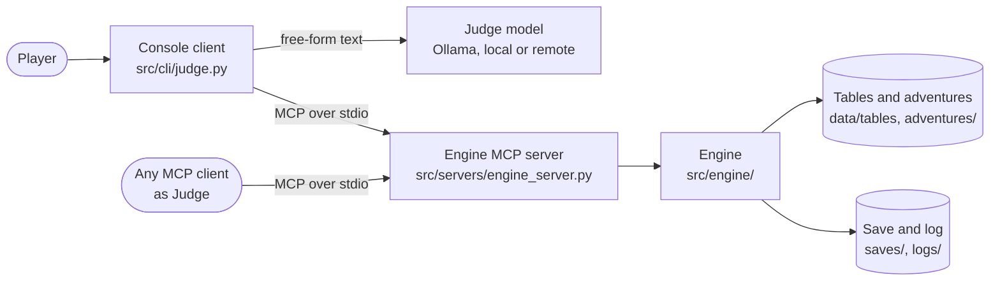

# Engine notes: first version

Written for review by the project owner. It records what the first engine does,
the decisions taken while building it, the DCC rules it follows, and the
questions saved for later. The rules themselves are in `design.md`.

## 1. What exists



| Part | Where | What it does |
|---|---|---|
| Engine | `src/engine/` | World model, time, light, checks, encounters, combat, actions, saving |
| Engine server | `src/servers/engine_server.py` | The engine as an MCP server over stdio |
| Console client | `src/cli/judge.py` | Starts the server and plays as the Judge, with or without a model |
| DCC rules | `src/rulesets/dcc.py` | Rule constants; loads the DCC tables |
| Game rules | `src/rulesets/game.py` | Loads this game's rules (`design.md`) |
| Tables | `data/tables/*.yaml` | Every table, DCC and game, as YAML |
| Adventure | `adventures/elders_secret/adventure.yaml` | The Elder's Secret as game data (milestone 1 subset) |
| Tests | `tests/` | 27 engine tests, 4 model tests |

**Turn flow.** The Judge sends the player's words to `command`. The engine's
own parser resolves plain commands directly. Anything else comes back with the
perceivable context; the Judge turns it into a proposal and calls `act`. The
engine validates and resolves it and returns events and a plain summary, which
the Judge narrates. This is design 3.2 carried over MCP.

**MCP tools:** `list_adventures`, `saved_game`, `new_game`, `resume_game`, `reset_game`, `get_context`,
`command`, `act`, `inventory`, `shop_stock`, `customize_character`, `character_sheet`, `encounter_level`,
`judge_guide`, and a `judge` prompt.

**Running it:**

```bash
python src/cli/judge.py                                  # no model: plain commands
python src/cli/judge.py --model gemma4-12b-128k:latest   # local Judge model
python src/cli/judge.py --adventures DIR --model llama3.1 --host http://server:11434
python src/servers/engine_server.py                      # the server alone, for another MCP client
# --adventures is the directory containing all adventures (default: adventures)
pytest -m "not model"                                    # fast tests
pytest -m model                                          # model tests (DCC_JUDGE_TEST_MODEL)
```

## 2. Built so far

Against `design.md` section 16, milestone 1:

| Slice | Status |
|---|---|
| 1. Movement, descriptions, time, torches, saving | Done |
| 2. Objects, saved changes, darkness, checks | Done |
| 3. Encounters and the MCP server | Done; the engine itself is the MCP server |
| 4. Combat, death, replacements, evidence, item of power | Combat, death and a goal done; replacements and adventure rules not yet |

Also done early: a basic shop and healing supplies, because a party without a
shop often has no torch or no way to light one.

## 3. Decisions to review

Each is implemented; change any of them.

### Architecture

| # | Decision | Why |
|---|---|---|
| A1 | The engine is the MCP server over stdio. The separate encounter-level server in design 12.2 is folded into it, and its rule is also exposed as the `encounter_level` tool. | Your instruction that the engine runs as an MCP server |
| A2 | MCP 2 API (`MCPServer`). `requirements.txt` now needs `mcp>=2.3`. | The installed MCP is 2.3; the old `FastMCP` servers could not start |
| A3 | Removed `dice_server.py`, `scene_server.py`, `character_server.py`, `scene_service.py`, `character_service.py` and `character_sheet.py` | Superseded by the engine (design 12.4); they are in Git history |
| A4 | All tables moved to YAML in `data/tables/`. `dcc.py` loads them under the same Python names | Your instruction |
| A5 | The client keeps the name `src/cli/judge.py` and has no default model | The README already pointed there; without a model the game still runs |
| A6 | One save slot, `saves/game.json`, recording which adventure was picked and where it came from; logs go to `logs/<adventure>.jsonl`, both ignored by Git. `DCC_JUDGE_DATA_DIR` moves them | Design 12.3 |
| A8 | The command line names the directory containing all adventures (`--adventures`, default `adventures`; from another folder it falls back to the project's own). A new game picks a funnel from it at random with the game's dice. Unusable adventure files are listed and skipped. `new_game` can still force one by path, http(s) URL (15-second timeout, 5 MB limit) or id | Your instruction |
| A7 | The engine accepts some sloppy model output: `"action"` for `"type"`, and `{"exit": "x"}` for `"x"` | Small models do this often |

### Rules

| # | Decision | Source |
|---|---|---|
| R1 | **`get_ability_modifier` was wrong** and now follows Table 1-1. Old values: 3 gave -2, 8 gave -1, 12 gave +1, 15 gave +2. | DCC Table 1-1 |
| R2 | The shield's fumble die changed from d8 to d4 | DCC Table 3-4 |
| R3 | Birth augur rolled at creation (d30 + Luck modifier) and applied to attacks, damage, checks, saves, AC, initiative, HP, finding traps and secret doors, crits and fumbles | DCC Table 1-2 |
| R4 | No untrained-weapon penalty at level 0 | DCC |
| R5 | Initiative: party d20 (d16 with a two-handed weapon) + leader's Agility; d20 per enemy group; party wins ties | DCC; ties are an assumption |
| R6 | Missile into melee: -1, and a miss has a 50% chance to hit an ally in front | DCC Table 4-1 |
| R7 | Recovering the body: d20 at or under Luck; success gives 1 HP, groggy for an hour (-4 to all rolls) and -1 to Strength, Agility or Stamina | DCC; the d20-under-Luck target is an assumption |
| R8 | Saves at level 0: Reflex from Agility, Fortitude from Stamina, Will from Personality | Assumption; not in the public compendium |
| R9 | Monster critical hits roll damage twice | Assumption; no public rule |
| R10 | Surprise in light: 1-2 on a d6 | Assumption; design said "normal rules" |
| R11 | Perception and searching use Intelligence and the vision die, not the occupation rule | Assumption |
| R12 | Group silence: Agility, DC 5, rolled by the least stealthy member with the occupation rule's die | Assumption |
| R13 | Striking a light: Agility DC 5, 10 minutes | Assumption |
| R14 | Lantern: 6 hours per flask of oil, starts empty. Candle: 60 minutes | DCC for oil; candle is an assumption |
| R15 | Rear-rank characters step into gaps in the front rank | Assumption; without it, a party whose front rank falls cannot fight back |
| R16 | When the leader falls, the next active character leads; the player can change it | Design 7 asks the player; this keeps play moving |
| R17 | The darkness multiplier is fixed when an action starts, even if a torch dies partway | Simplicity |
| R18 | Fallen characters are checked automatically in the aftermath of a won fight | Design 9.3 |
| R19 | Fumble 6's armour penalty is cleared in the aftermath of a fight | Your rule that the aftermath includes tightening gear |
| R20 | Crit and fumble results: "drops to the bottom of initiative" and a creature's disarm each cost that creature its next action; speed penalties and free attacks have no effect yet | Design 11.2 for speed |
| R21 | A quick repair breaks for good at the end of the next fight | Design 4.7 |
| R22 | Coins count one per copper piece, 100 per slot | Design 11.2 |
| R23 | Shop: buying draws on the whole party's money. Haggling is one Personality check (occupation rule die); 15+ gives 75%, 6-14 gives 50%, 5 or less gives 25%; the result is saved per item | Design 8.3; bands are assumptions |

### Adventure data

| # | Decision |
|---|---|
| D1 | The game begins in the village tavern (design 13). The engine adds the tavern, the shopkeeper and the road to every adventure from `data/village.yaml`. Gleaning takes 30 minutes; the road takes 3 hours each way and burns no torch time; the deadline starts on first departure. Survivors win on returning to the village |
| D2 | Milestone 1 goal: bring out the satchel **and** the tablet. Maud, the witness, is not implemented yet |
| D3 | The forge crew is neutral until provoked. Taking the satchel or coin jar while they are present needs a successful silent attempt; "under cover of the anvils" succeeds while the forge is not alerted |
| D4 | Gate sentries are unaware: entering without sneaking, or a loud noise, starts the fight |
| D5 | Wound dressings: 30 cp, 3 in stock, 1d4 HP, 10 minutes |
| D6 | Encounter entries for the runt, the voice and the Gleaner are messages only for now |

## 4. DCC rules: public sources

Read from the public compendium at <https://roll20.net/compendium/dcc/>:
Character Creation, Equipment, Combat and the Starter Rules. Translated into
code or YAML: Tables 1-1, 1-2, 1-3 (occupations), 3-3, 3-4, 4-1, 4-2, Crit
Table I, initiative, attack and damage, crits and fumbles, untrained weapons,
missile into melee, recovering the body, natural healing, Luck burn rules,
0-level HP and funds, oil burn time.

**Not found publicly** (the core rulebook is needed): torch and candle burn
times, light radius, infravision, 0-level save abilities, the trained/untrained
skill die, armour check penalty targets, searching and secret doors, monster
critical hits, falling damage, morale, the Luck check target, and the class
pages for elves, dwarves, halflings and thieves. Each gap uses a decision from
`design.md` or an assumption in section 3.

## 5. Not implemented yet

Saved for later in `backlog.md`.

## 6. Known limitations

- **Narration can still be wrong.** Gemma 4 12B stayed close to the report in
  testing; Qwen 3.5 4B added details. An external Judge could also narrate
  without calling `act`.
- Scene history notes use the items' daylight names, so they can name things
  in the dark that the party handled earlier.
- Model tests use `gemma4-12b-128k:latest` and take about 45 seconds.

## 7. Questions saved for later

1. Remote models: only Ollama is supported, locally or on a remote host. Do you
   also want a hosted provider such as Anthropic or an OpenAI-compatible API?
2. Should the console client default to a model, for example
   `gemma4-12b-128k:latest`, instead of plain commands?
3. Do you accept the corrected ability modifiers (R1)? They make characters
   weaker than before in places, but match DCC.
4. Should the tavern's name be rolled like the village's (now done), or fixed per village?
5. Which assumptions in section 3 would you like to replace with the core
   rulebook's rules?
